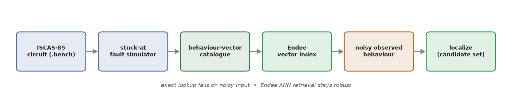
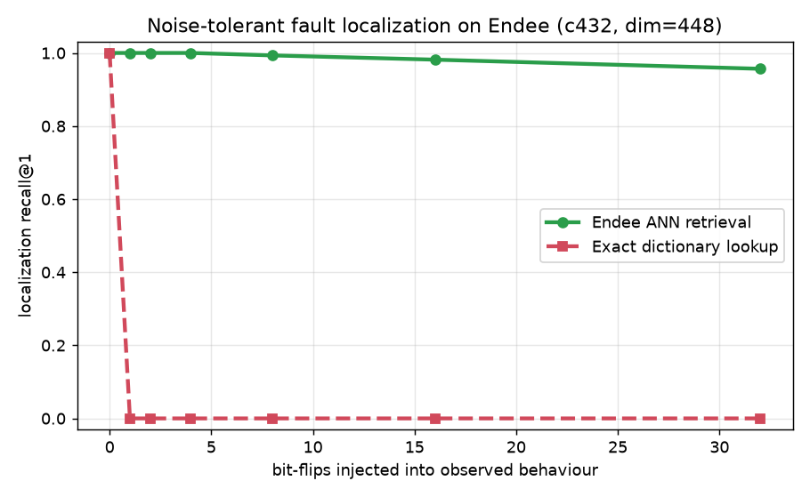

<div align="center">

# Endee VLSI Fault Localizer

### Noise-tolerant VLSI fault localization on the [Endee](https://endee.io) vector database

[](LICENSE)
[](requirements.txt)
[](https://endee.io)
[](data/bench)

*When a chip's response is noisy, exact fault-dictionary lookup fails — Endee's approximate retrieval still finds the fault.*



</div>

---

## TL;DR — the result

Locate a fault from a chip's output behaviour by retrieving the nearest known fault
behaviours from Endee. The payoff is **noise tolerance**: corrupt the observed response
and exact dictionary lookup collapses, while Endee's ANN retrieval keeps localizing.

<div align="center">



</div>

| bit-flips in observed response | 0 | 1 | 2 | 4 | 8 | 16 | 32 |
|---|---|---|---|---|---|---|---|
| **exact dictionary lookup** | 1.00 | **0.00** | 0.00 | 0.00 | 0.00 | 0.00 | 0.00 |
| **Endee ANN retrieval** (c432) | 1.00 | 1.00 | 1.00 | 1.00 | 0.99 | 0.98 | 0.96 |
| **Endee ANN retrieval** (c880) | 1.00 | 1.00 | 1.00 | 1.00 | 0.99 | 0.99 | 0.99 |

Exact lookup dies at a **single** flipped bit. Endee ANN holds ~96–99% at **32** flips.

```bash
python examples/demo.py --circuit c432     # blind localization + live noise demo
```

---

## 1. Problem

A classic way to locate a fault in a digital circuit is a **fault dictionary**: simulate
every candidate fault, record the **output behaviour** it produces under a battery of test
patterns, and store it. When a real chip misbehaves, match its observed behaviour against
the dictionary to find the candidate fault site(s). Faults that produce *identical* outputs
are physically indistinguishable, so the honest answer is a **candidate set**, not a point.

The weakness: dictionaries are matched **exactly**. If the observed response is slightly
corrupted (measurement noise, a partial capture), the exact match fails and the method
returns *UNKNOWN* — it localizes nothing.

## 2. Why this is a vector-database problem

A fault dictionary *is* a vector store with payloads: **behaviour vector → candidate sites**.
Exact lookup is a hashmap. The genuinely vector-database-shaped question is **approximate**
retrieval: given a *noisy* behaviour, return the nearest known fault behaviours — which is
what an ANN index does, and it buys noise tolerance that exact lookup fundamentally cannot.

The vectors must be **locality-preserving** (a small response change = a small vector
change). We therefore index **raw behaviour** (circuit outputs across test patterns), never
a hash of it — hashing destroys the locality that makes approximate retrieval meaningful.

## 3. How Endee is used

| Step | Endee feature |
|---|---|
| one index per circuit | `create_index(dimension=D, space_type="l2", precision=FLOAT32)` |
| each fault → one object | `vector` = behaviour bits · `meta` = `{net, sa, behaviour}` · `filter` = `{circuit}` |
| retrieval | `idx.query(vector=..., top_k=24, filter=[{"circuit": {"$eq": c}}])` |
| metric | server `similarity` field = **Hamming distance** (0 = identical behaviour) |
| verdicts | `FAULT_FREE` · `EXACT` (sim 0, one fault) · `AMBIGUOUS` (sim 0, candidate set) · `UNKNOWN` (no exact match → ANN-nearest surfaced) |

Runs against a free, self-hosted Endee server (`endeeio/endee-server`, no account) —
see [`docs/RUN_ENDEE.md`](docs/RUN_ENDEE.md).

## 4. Results in full

Catalogues are generated by our own stuck-at fault simulator ([`endee_vlsi/faultsim.py`](endee_vlsi/faultsim.py))
on standard ISCAS-85 benchmarks. **Every** catalogued fault localizes correctly:

| circuit | stuck-at faults | detected | localized correctly | EXACT | AMBIGUOUS | vector dim |
|---|---|---|---|---|---|---|
| c432 | 392 | 366 | **366 / 366** | 158 | 208 | 448 |
| c880 | 886 | 833 | **833 / 833** | 332 | 501 | 1664 |

Noise-tolerance charts for both circuits are in [`results/`](results).

## 5. Honest analysis of fit

Read this before concluding Endee is doing something magic — it isn't, and saying so is the
point (full version in [`docs/HONEST_LIMITS.md`](docs/HONEST_LIMITS.md)).

- **At this scale a vector DB is not strictly necessary** — hundreds-to-thousands of
  vectors; an in-memory scan would also work. Any vector DB is more than the raw size needs.
- **Graceful degradation is an ANN-general property**, not Endee-specific; the same curve
  would appear on FAISS/Qdrant. The chart validates the **paradigm**, not a unique feature.
- **Where this becomes genuinely Endee-shaped:** at **scale** (a chip *family* / fab fault
  corpus = millions–billions of behaviour vectors, Endee's single-node billion-vector
  regime) and at the **edge** (offline/air-gapped tester-side diagnosis, no cloud round-trip).
  This project is the honest first step toward that regime.

## 6. Quickstart

```bash
# 1. deps
python -m venv .venv && . .venv/Scripts/activate          # Windows: .venv\Scripts\activate
pip install -r requirements.txt

# 2. start the free self-hosted Endee server (Docker) — details in docs/RUN_ENDEE.md
docker run -d --ulimit nofile=100000:100000 -p 8080:8080 \
  -v endee_data:/data --name endee-server endeeio/endee-server:latest

# 3. build a catalogue, validate localization, see the noise demo, reproduce the chart
python endee_vlsi/build_catalogue.py c432 --patterns 64
python endee_vlsi/localize.py c432
python examples/demo.py --circuit c432
python endee_vlsi/noise_experiment.py c432
```

## 7. Layout

```
endee_vlsi/   faultsim.py  build_catalogue.py  index.py  localize.py  noise_experiment.py  client.py
examples/     demo.py
data/         bench/*.bench   catalogue_*.jsonl   golden_*.json
results/      noise_recall_*.png / .json
docs/         RUN_ENDEE.md   HONEST_LIMITS.md
```

---

## Author & attribution

Built by **Pavan D** — [GitHub](https://github.com/pavannithin224-abcd) ·
[LinkedIn](https://www.linkedin.com/in/pavan-d-96aab62a8).

This project builds on the fault-dictionary concept from **Faultiva** (CircuitSage-HMAC), a
deep-learning VLSI fault detection/localization system **designed and built from scratch by
Pavan D**. Faultiva is his own independent work; this repository is a separate, self-contained
application that generalizes its idea onto a vector database. It is not affiliated with or
endorsed by Endee, and uses Endee only as an external vector-database component via its public SDK.

Licensed under **Apache-2.0** — see [`LICENSE`](LICENSE) and [`NOTICE`](NOTICE).
